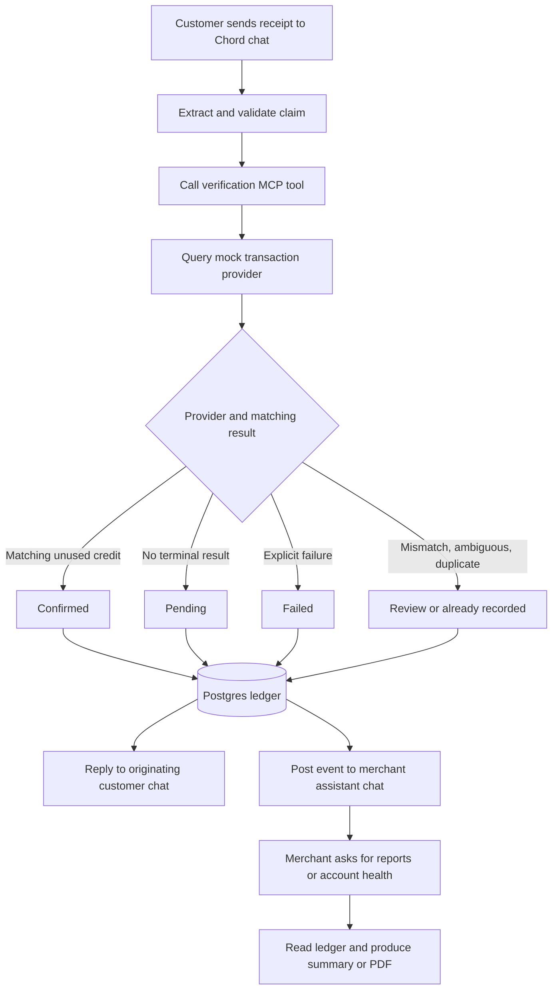

# Merchant payment verification assistant

## Product flow

Customers send Nigerian bank transfer receipt images or PDFs to a Chord teammate over WhatsApp. The teammate extracts the claimed sender, amount, currency, reference or session ID, recipient account, and transfer time. An external verification tool queries an authorized merchant transaction feed and records exactly one outcome for the attempt. The customer receives that outcome. The merchant's dedicated assistant chat receives the same outcome as a live feed and accepts report requests.

The receipt is evidence of a *claim*, not proof of an incoming credit. Confirmation requires a provider-reported credit to the configured merchant account with matching amount, currency, and reference. Missing credits remain pending. An explicit provider failure is failed. Mismatches and ambiguous matches require review. The service must never infer financial status directly from OCR text or the first digit of a reference.

For the exercise, a seeded mock provider returns deterministic outcomes for numeric reference families. This behavior is isolated behind a provider interface, so the verification logic continues to query it as an external system. The reference prefix is a test fixture selector, not an agent instruction. All fixtures use invented names, accounts, and transaction IDs.

## Identities and messaging

- One merchant owns a configured set of receiving accounts and one assistant chat. Any number of customer chats may submit claims to that merchant.
- A customer's verification result must only go to their originating chat. The merchant feed gets the result from the same saved event, avoiding conflicting statuses.
- A pending claim has a stable attempt ID. If its provider status changes, append a resolution event linked to that ID and mark the ledger row resolved. If the channel supports editing the original merchant message, tag it there; otherwise post a linked follow-up that names the pending attempt. Do not silently overwrite history.
- Delivery of either message is retryable and idempotent. Message delivery failure must not alter the payment result. Track customer and merchant delivery separately.
- Hourly health warnings are sent only when the threshold is crossed or the unhealthy condition materially changes, not on every payment.

## Data and invariants

Postgres tables: merchants, merchant_accounts, payment_attempts, provider_transactions, verification_events, outbound_messages, and report_jobs. Store timestamps in UTC; render reports in the merchant's configured timezone (Africa/Lagos for the demo). Keep a unique key on merchant + normalized provider reference, plus provider transaction ID where available. Persist an audit event for every decision and later status change.

The seeded provider must expose attempted transactions, including failed and pending ones. A feed containing only credits cannot supply the denominator for a failure-rate calculation.

Hourly account health uses the last 60 minutes of **distinct attempts** for one receiving account. Let `n` be the count of attempts and `bad` the count whose current status is pending or failed. Flag the account when `n > 20` and `bad / n >= 0.50`. Pending is counted for the operational warning but remains distinct from a confirmed provider failure in all messages and reports. A later resolution recomputes the window. The warning can recommend a backup account only if the merchant configured one and its recent health is acceptable.

## Deployment shape

- Chord skill: business context, extraction requirements, tool rules, response language, and escalation boundaries.
- Railway web service: authenticated merchant portal, Streamable HTTP MCP endpoint and internal API backed by Railway Postgres.
- Seeded mock provider: a separate logical API boundary, preferably a second Railway service, so tool calls traverse an actual external HTTP interface.
- Receipt extraction: PDF text first; OCR for screenshots and scanned PDFs. Return confidence and missing fields. When reference or amount is uncertain, ask the customer for clarification before verification.
- Reports: query the ledger for day, week, or month; return a concise merchant-chat summary and generate a PDF artifact when the channel supports delivery.

Each merchant signs up with a shop name, email, password and merchant WhatsApp number, then configures a primary and backup receiving account. Every account, attempt, report and channel destination is scoped to that merchant. A customer message must resolve to one merchant through its Chord channel/workspace identity; the customer must never select an arbitrary merchant ID in a tool call. The portal stores merchant configuration only; entering an account number does not grant access to a real bank feed. Such access requires a separate authorized integration.

## First integration probes

1. Confirm that the Chord WhatsApp simulator passes PDF and image attachments or retrievable URLs to the teammate/tool.
2. Confirm whether a customer-triggered run can post to the merchant's separate assistant chat, and whether a prior message can be edited. Use linked follow-ups if editing is unsupported.
3. Register the public HTTPS MCP server, discover its tool schemas, health-check it, and verify an actual tool call in a simulator conversation.
4. Verify how Chord delivers generated PDF artifacts in the simulator.

These capabilities must be demonstrated rather than assumed. The central end-to-end test is one customer receipt that causes a persisted verification result, one customer response, and one merchant feed event.
